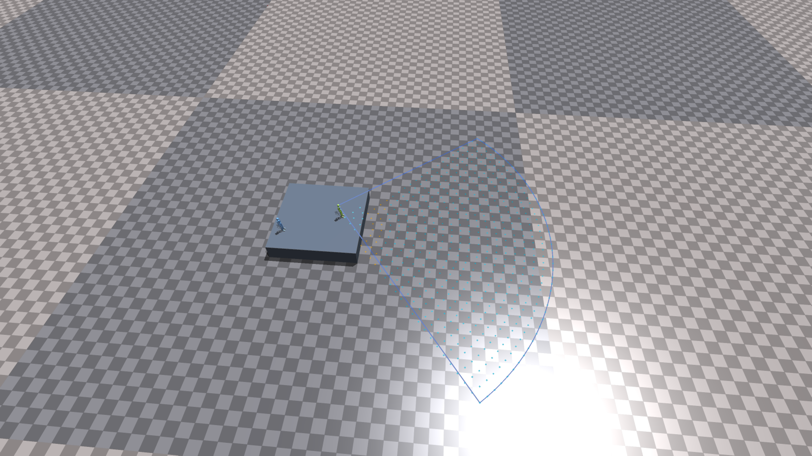
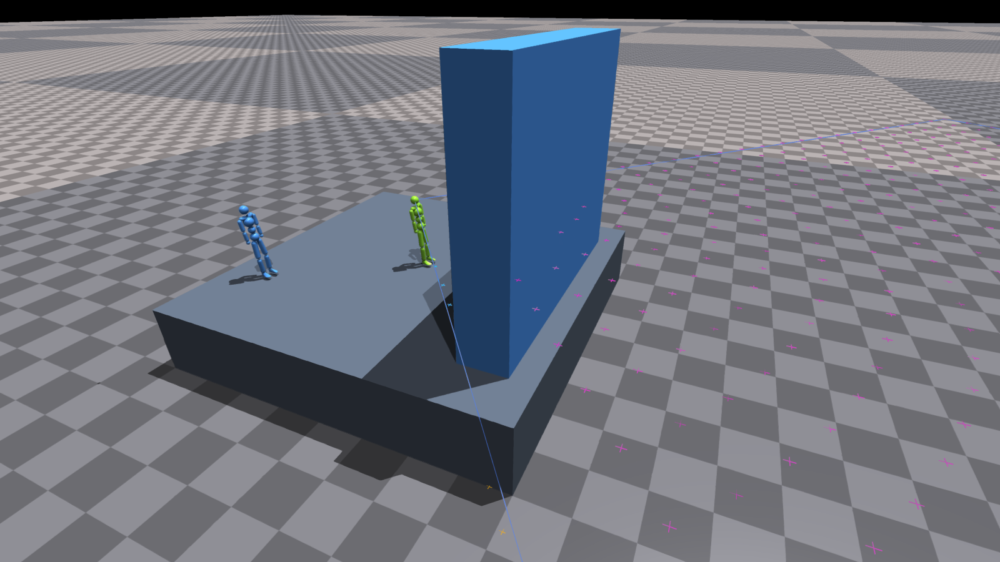
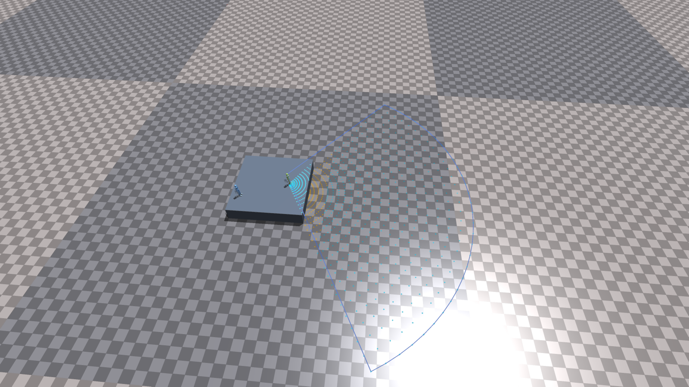
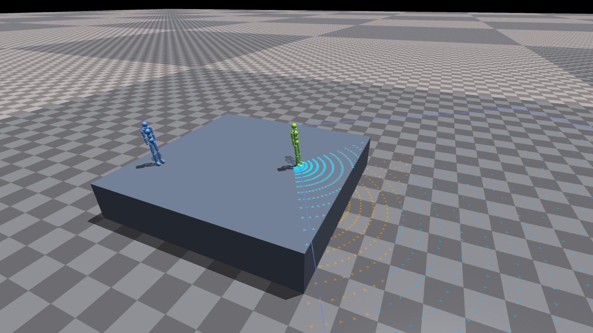
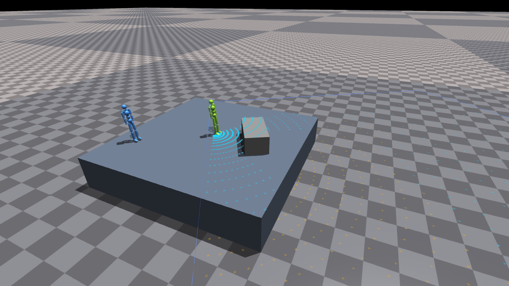
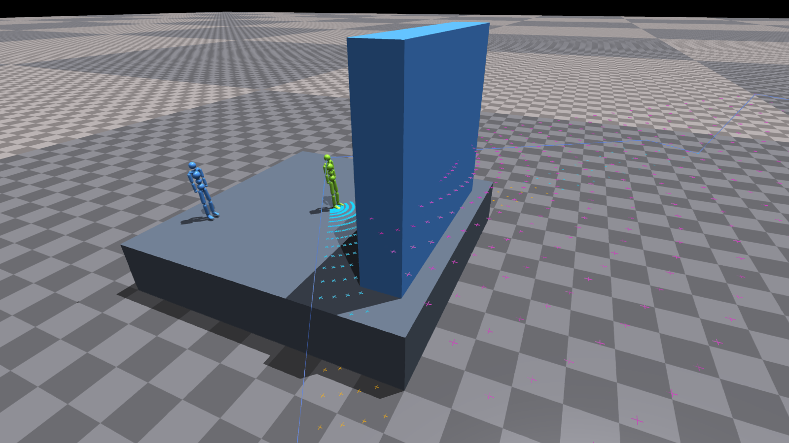
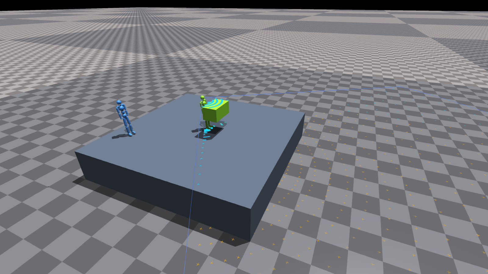
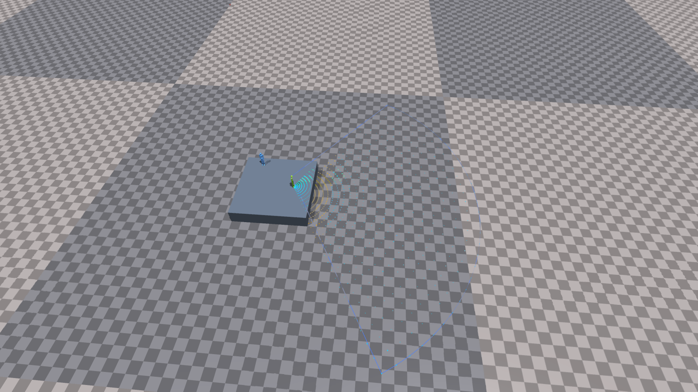

# 전방 부채꼴 높이 센서

아래 관측 계약은 단일 무대 576개 실험(sensor metadata version 3) 기준이다. **두 무대·연결다리 실험(version 4)**은 사용자 결정에 따라 다음이 다르다.
- 가림 판정과 뒤쪽 채움을 없앴다. 무대 A·B, 다리, 과제 상자의 yaw 발자국과 최상단 모서리 높이를 가려진 곳까지 수직 조회한다(`sensor_occlusion: none`).
- 32고리 1024개를 쓴다. 관측은 2655차원이다.
- 가림 판정이 있으면 간격이 멀리서 무대 B 높이로 채워져 다리 유무를 구분할 수 없어서 바꾼 것이다.
- 다리는 지형이므로 항상 포함한다. 과제 상자 포함과 향후 carryWith 제외 요구는 그대로다.

실행 방법은 [config.md](config.md#stage-2-두-무대연결다리)에 있다.

## 관측 계약

- 머리 rigid body의 로컬 `[0, 0, 0.175]m` 위치(현재 humanoid asset의 머리 구 중심)를 시점·부채꼴 XY 원점으로 사용한다. 머리의 pitch/roll은 원점 위치에 반영하지만 부채꼴 방향은 pelvis/root heading을 따른다.
- 전방 **100도**, 최대 XY 거리 **10m**. 24개 고리에 `1, 3, 5, …, 47`개씩 배치해 에이전트당 **576차원**, 2명과 기존 scene 607차원을 합쳐 **1759차원**이다.
- 고리 폭은 `10/24 ≈ 0.417m`, 대표 반경은 `(i+0.5)×10/24`다. 각 고리의 각도 구간 중심을 샘플링하므로 셀당 면적이 같고 접선 방향 간격은 약 0.364m다. 범위 경계는 ±50도/10m이며, 최외곽 샘플 반경은 9.792m다. 가까운 고리부터, 고리 안에서는 왼쪽 각도부터 저장한다. 0–2.5/2.5–5/5–7.5/7.5–10m의 점 개수는 36/108/180/252개다.
- 각 XY에서 무대·지면·상자의 가장 높은 표면을 구한다. 상자는 현재 위치·전체 quaternion 회전을 반영한 OBB다. 머리→표면 선분과 모든 무대/상자 OBB의 교차로 가림을 판정하므로 샘플 사이의 얇은 장애물도 가릴 수 있다.
- 직접 보이면 실제 높이, 가려졌으면 **다음 고리에서 각도가 가장 가까운 점을 연결한 경로의 첫 직접 관측 높이**로 채운다. 경로 끝까지 직접 관측이 없으면 미관측이다. 고리마다 각도가 달라 연결 방향이 조금씩 이동하는 근사이며, 얇은 장애물이나 높이 경계에서 이웃 방향의 높이를 가져올 수 있다. 표면 조회·가림 판정은 기존의 정확한 OBB 교차를 유지한다. 가려진 실제 높이는 채움에 사용하지 않는다.
- 높이값은 기존처럼 `(표면 높이 − pelvis 높이)`를 ±3m로 clip하고 3으로 나눈다. 미관측은 그 계산 뒤 **2.0**을 넣는다. 관측과 추정의 구분은 정책에 추가 전달하지 않는다. 상태 구분은 테스트·시각화에서만 사용한다.
- 지형과 물체는 해당 환경만 조회한다. 다른 병렬 환경과 자기/동료 신체는 가림 대상이 아니다. 물체 토큰은 기존대로 유지되므로 정책 전체가 시야만으로 제한되는 실험은 아니다.
- 정사각형/이전 1024개 부채꼴과 차원·배치가 다르다. sensor metadata version 3과 별도 기본 output `approach_stage2_fan_sensor_576_100_10m`을 사용하며 이전 센서 checkpoint를 바로 평가하거나 resume할 수 없다. Stage 1에서 전이 학습한다.

## 계산 최적화

- 수직 조회의 동일한 ray 방향을 샘플마다 회전하던 중복을 제거한다. 물체 회전행렬은 표면 조회와 가림 판정에서 공유한다. 무대도 다른 상자와 동일한 OBB 알고리즘으로 처리한다.
- 1–4환경은 물체를 최대 4개씩 묶어 GPU 호출을 줄인다. 그보다 많은 환경은 물체 하나씩 처리해 큰 중간 텐서의 메모리 이동을 줄인다. 환경·에이전트·센서 축은 모두 텐서 연산으로 병렬 처리한다.
- 뒤쪽 채움은 사전 계산한 고리 연결을 5번의 병렬 gather로 따라간다. 보이는 점은 그대로 보존한다.
- viewer는 관측 계산에서 저장한 env 0의 결과만 재사용한다. 매 프레임 별도의 표면/가림 계산을 하지 않는다. 부분 reset에서는 env 0이 포함될 때만 해당 캐시를 갱신한다.
- watch 기본 출력은 `output/approach_stage2_fan_sensor_576_100_10m_watch`다. 현재 576개/100도/10m checkpoint끼리만 resume한다. 이전 20m checkpoint도 sensor metadata가 달라 직접 resume할 수 없다.

## 현재 상자 포함의 적용 범위 — 향후 carryWith에서 반드시 재검토

**사용자 결정:** 현재 낙하 시나리오는 상자를 드는 행동을 하지 않는 전제이므로 상자 표면을 센서에 포함한다. 이는 `carryWith`를 위한 최종 설계가 아니다. 운반 중인 상자의 높이가 센서에 들어오면 지형 판단·학습을 방해할 수 있다는 우려가 있으며, **향후 carryWith 적용 시에는 상자를 제외해야 한다.** 현재 포함 결정을 운반 실험으로 그대로 이어가지 않는다. 학습 저하 자체를 이번 검증에서 입증한 것은 아니다.

현재 구현은 상자를 **높이 표면과 가림 판정 양쪽**에 포함한다. 향후 제외 구현에서는 (1) 모든 상자 또는 운반 중인 상자만 제외할지, (2) 높이 관측만 제외할지 또는 가림에서도 제외할지를 명시적으로 결정해야 한다. 지금은 제외 옵션을 구현한 상태가 아니다. 이 변경은 sensor metadata와 별도 실험 설정에도 반영해야 한다.

가까운 운반 상자가 무대 표면을 가리고 먼 낮은 바닥만 보이게 하면, 현재 채움 규칙은 가려진 무대까지 낮은 바닥으로 추정할 수 있다. 이는 상자 포함/채움 방식의 구체적인 한계이며, carryWith 검토에서 함께 다뤄야 한다. 센서는 XY별 최상단 표면 높이를 읽으므로 벽의 수직 면이나 상자 아래 공간을 여러 층으로 표현하는 실제 LiDAR/depth 센서와는 다르다.

## 시각화와 검증의 의미

- 하늘색 십자: 직접 관측한 표면 높이.
- 노란색 십자: 뒤쪽 관측 높이로 채운 위치. 실제 가려진 표면의 정답 표시가 아니다.
- 자홍색 십자: 미관측. 높이가 없으므로 **머리보다 0.15m 높은 표시 평면**에 띄운다. 실제 지형이나 정책의 높이값 2m를 의미하지 않는다.
- 파란 윤곽선: 최외곽 고리의 샘플 양 끝과 원호 연결. 셀 경계인 정확한 ±50도/10m보다 조금 안쪽이다.

`tokenhsi/tests/fan_sensor_capture.py`는 실제 Isaac Gym viewer에서 절벽, 낮은 회전 상자, 높은 벽, 운반 높이에 둔 상자, heading 90도 상황을 촬영한다. 상자 크기·위치를 통제하고 중력을 끈 **센서 검증 장면**이며, 정책의 상자 운반이나 회피 성공을 보여주는 평가가 아니다. 원본 PNG와 실제 센서 배열 NPZ, 상태별 개수 JSON을 함께 저장한다.

## 이전 576개·100도·20m 버전 검증 (2026-09-29)

아래 학습 결과·성능 측정·스크린샷은 거리 변경 전 **20m 버전**이다.

- CPU/회귀 테스트 **25개 통과**. 균일 셀 면적·고리별 개수·가장 가까운 후방 연결·순차 기준과 병렬 채움의 일치·회전 OBB 묶음 처리 및 기존 절벽/센서 검증을 포함한다.
- GPU 0에서 2048환경 전이 학습 2 epoch와 checkpoint 저장, 16환경·64-step 평가를 완료했다. noVNC 4환경 전이 학습 2 epoch와 해당 checkpoint의 1환경 resume 4 epoch 도달도 확인했다. 새 입력은 576차원/agent, 전체 관측은 1759차원이다.
- 세 학습 실행의 actor encoder tensor 75개와 관찰 RMS는 Stage 1과 같고, 새 센서 입력의 head 가중치는 갱신됐다. TensorBoard scalar는 각각 173/151/173종 모두 유한값이다. 이전 1024개 checkpoint 혼용도 차단된다. 이는 짧은 실행 확인이며 장기 회피 성능 검증은 아니다.
- 실제 viewer의 가림 장면 5개에서 PNG 10개와 NPZ 5개를 생성했다. 표시용 캐시가 관측과 같고, 그리기 함수가 센서를 재계산하지 않는지도 검증했다.

| 환경 수 | 이전 1024개·120도 | 이전 계산 코드에 576개 입력 | 현재 576개·100도 |
| --- | ---: | ---: | ---: |
| 2048 | 12.131ms | 6.071ms | **4.825ms** (물체 1개씩) |
| 4 | 3.363ms | 3.367ms | **1.116ms** (물체 최대 4개씩) |

GPU 센서 함수만 CUDA event로 15회씩 5라운드 측정한 중앙값이다. 공유 GPU 부하에 따라 달라지며 전체 학습 속도나 viewer FPS의 배율을 뜻하지 않는다. 가운데 열은 점 개수에 따른 계산량 비교용이며 이전 채움 배열을 사용하므로 새로운 관측 의미를 평가한 결과가 아니다. 동일 XY의 표면 높이는 기존 구현과 수치 허용오차 내 일치했다. 운영 경로(4환경 묶음/2048환경 개별)는 가림 상태도 기준과 같았다. 비교용 2048환경 전체 묶음에서는 회전 물체 경계의 부동소수점 오차로 2/2,359,296개의 가림 상태가 달랐으며, 이 경로는 현재 사용하지 않는다.

산출물: [실행·checkpoint 검증](../output/approach_stage2_fan_sensor_576_check/verification.json), [벤치마크](../output/approach_stage2_fan_sensor_576_check/benchmark.json), [가림 장면 통계](../output/approach_stage2_fan_sensor_576_check/screenshots/scenarios.json).

20m 버전의 균일 배치 전체 모습:

높은 벽에 가려진 영역은 자홍색으로 표시된다:

## 이전 1024개·120도 버전의 검증 결과 (2026-09-29)

- CPU/회귀 테스트 **22개 통과**: 120도/20m/1024개 좌표, 절벽 가림과 원거리 재노출, 뒤쪽 채움, 미관측 2.0, 얇은 장애물, 운반 높이 상자와 시점 비교, 기울어진 OBB, 독립 SciPy/scalar 교차 기준, 환경 이동·heading 회전, checkpoint 혼용 차단.
- GPU 0에서 **2048환경·MAX_ITERATIONS=1(2 epoch)** 전이 학습과 checkpoint 저장 완료. Actor encoder tensor 75개와 관찰 RMS 불변, head의 새 센서 입력 가중치 norm 0.0513, TensorBoard scalar 173종 모두 유한값.
- 저장 checkpoint의 16환경·64-step headless 평가와 1환경·16-step VNC 평가 완료. 이는 실행 검증이며 절벽 회피 성능·장기 학습 수렴 검증이 아니다.
- 센서 장면 5개를 실제 viewer에서 원경/근경으로 촬영한 원본 PNG 10개와 NPZ 5개를 저장했다. 아래는 agent 0의 1024개 샘플 상태다. 모든 장면의 전체 관측은 2655차원이다.

| 장면 | 직접 관측 | 뒤쪽 높이로 추정 | 미관측 |
| --- | ---: | ---: | ---: |
| 절벽 | 880 | 144 | 0 |
| 낮은 회전 상자 | 762 | 262 | 0 |
| 높은 벽 | 484 | 42 | 498 |
| 운반 높이의 상자 | 431 | 593 | 0 |
| heading 90도 | 880 | 144 | 0 |

검증 산출물: [checkpoint audit](../output/approach_stage2_fan_sensor_check/checkpoint_audit.json), [장면 통계](../output/approach_stage2_fan_sensor_check/screenshots/scenarios.json), [테스트 로그](../output/approach_stage2_fan_sensor_check/tests.log), [학습 로그](../output/approach_stage2_fan_sensor_check/train.log), [평가 로그](../output/approach_stage2_fan_sensor_check/eval.log). 실행 명령은 [config.md](config.md#stage-2-부채꼴-비전-센서)에 있다.

### 이전 1024개·120도 버전의 실제 viewer 화면

전체 부채꼴: 머리에서 heading 방향으로 뻗으며 근거리가 촘촘하다.

절벽 근경: 무대 바로 아래 가려진 샘플은 노란색으로 표시되며, 뒤에서 보이는 지면 높이로 채워진다.

낮은 회전 상자: 보이는 상판은 높이를 유지하고, 그 뒤의 가림은 더 먼 관측으로 채운다.

높은 벽: 해당 방향의 끝까지 뒤가 보이지 않으면 미관측 2.0이다. 자홍색은 머리 위 표시 평면의 디버그 마커다.

운반 높이의 상자: 상판 높이가 입력되고 가려진 영역도 넓어진다. 상자가 무대 시야를 가려 일부 무대 위치까지 먼 낮은 바닥으로 추정된다. **실제 운반 정책의 행동이 아니라 상자를 정적으로 배치한 센서 검증**이며, 향후 carryWith에서 상자 제외가 필요한 이유를 보여준다.

heading을 90도 회전한 경우: 부채꼴 방향이 함께 바뀐다.

