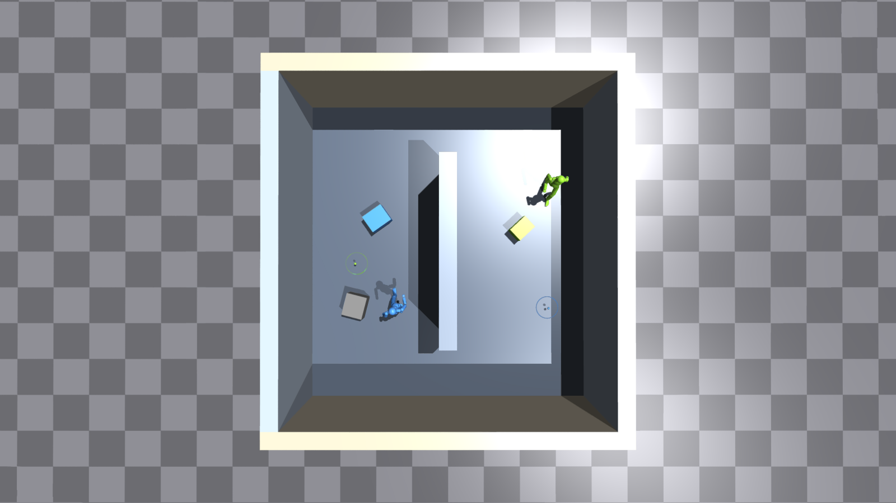
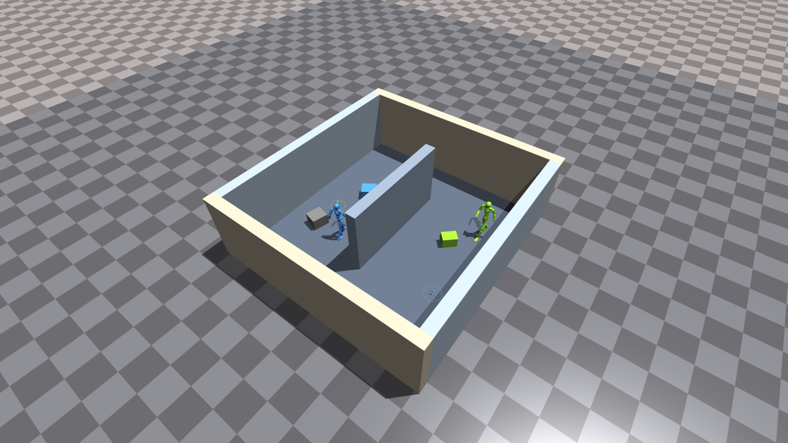
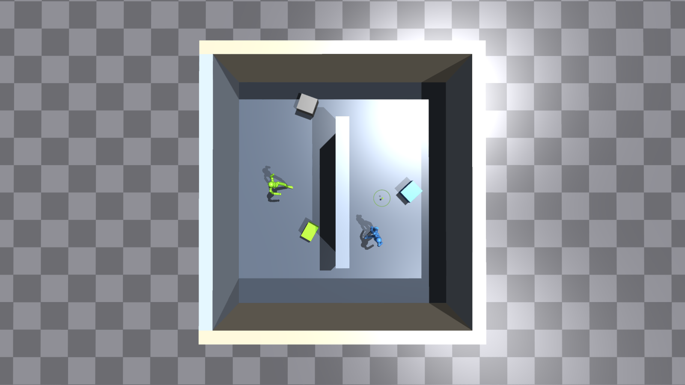
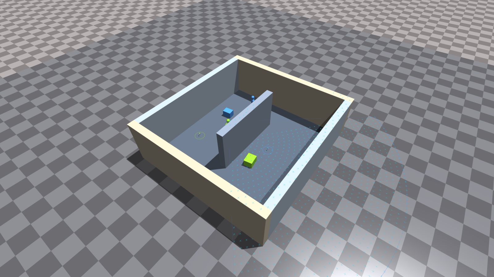

# Room: HOLDING_AT·내부 칸막이 구현 및 실제 화면

2026-09-30 · `approach_stage2_fan_room_partition`

> 이 보고서는 초기 배치와 화면의 기록이다. 현재는 HOLDING/HOLDING_AT의 픽업도 50% 확률로 칸막이 반대편에서 시작한다. 최신 배치·checkpoint 호환 규칙·명령은 [config 실행 가이드](config.md#stage-2-room-partition--holding_at내부-칸막이)를 따른다.

**4면 벽 안에 내부 칸막이를 추가하고, HOLDING·SIT·CLIMB·HOLDING_AT을 각각 25%로 설정했다.** 두 에이전트와 상자 3개는 모두 실내에서 시작한다. HOLDING_AT의 상자와 목적지는 칸막이 반대편에 배치된다.

## 1. 두 에이전트의 운반 과제를 위에서 본 모습



- **연두색 사람 → 연두색 상자 → 연두색 원**, **파란색 사람 → 파란색 상자 → 파란색 원**이 각각의 과제다.
- 색깔 있는 원이 실제 목적지다. 원 안의 작은 표시는 기존 goal marker이며, 회색 상자는 비할당 객체다.
- 자기 상자는 자신과 같은 쪽, 목적지는 칸막이 반대편에 있다. 상자와 목적지를 잇는 직선은 칸막이에 막힌다.
- 칸막이 양 끝의 통로로 돌아갈 수 있다. 목적지는 모두 외벽 안에 있으며, 닫힌 방 밖의 도달 불가능한 목표를 주지 않는다.

이 장면은 두 사람의 HOLDING_AT 관계를 함께 확인하도록 촬영 시 두 과제를 HOLDING_AT으로 지정하고, 목적지 원이 사람과 겹쳐 보이지 않는 초기 배치를 골랐다. **실제 학습 설정은 네 과제 각각 25%**다. 학습된 우회 행동을 촬영한 장면은 아니다.

## 2. 사선 전경과 치수



| 항목 | 설정 |
| --- | --- |
| 방 내부 | 가로·세로 각각 6–8m, 0.5m 단위; 환경 생성 시 고정 |
| 촬영한 방 | 7.5 × 8.0m |
| 외벽·칸막이 | 실내 바닥 위 높이 2.5m, 두께 0.4m |
| 내부 칸막이 | 방 중앙, 긴 방향은 Y축; 촬영 장면에서 길이 4.4m |
| 통로 | 칸막이의 양 끝과 외벽 사이에 각각 1.8m |
| 바닥 | 외부 지면 위 0.1m 고정 slab |
| 배치 | 사람 2명·객체 3개; 물리 객체끼리 초기 겹침을 배제 |

상자 3개 중 과제 대상인 두 상자는 칸막이 길이 안쪽의 좌우 영역에 배치한다. 비할당 상자는 실내에서 더 넓게 샘플한다. 미래의 목적지는 현재의 다른 에이전트와 가까울 수 있지만, 초기 상자와 겹치지 않게 한다. 작은 방에 큰 상자가 배치되는 경우까지 CPU 검사와 2048환경 학습으로 확인했다.

목적지 Z는 **바닥 높이 + 운반할 상자 높이의 절반**이다. 보상에서 비교하는 상자 중심 좌표와 맞춘다. 과제의 무작위 객체 binding·goal slot을 따라 위치와 색을 설정하므로, 에이전트 번호와 goal slot 번호가 달라도 올바른 목표를 사용한다.

## 3. 실제 25% 혼합 설정의 예시와 센서



위 장면은 기본 분포에서 나온 **연두색 HOLDING_AT·파란색 CLIMB** 조합이다. 활성 운반 목적지는 연두색 원 하나만 표시한다. 비활성 goal은 통로의 중립 위치에 두고 표시를 숨긴다.



센서 확인 장면에서는 연두색 사람을 칸막이 옆에 세우고 칸막이 쪽을 보게 했다. 하늘색 십자는 실제 높이 관측 샘플이다. 칸막이 상단에도 관측점이 찍힌다. 1024개·100도·10m·가림 없는 설정이므로 칸막이 너머의 바닥·객체도 조회한다.

외벽과 칸막이는 물리 actor와 센서 표면에 포함한다. 정책의 graph에는 벽 토큰을 추가하지 않으며, 관측은 기존과 같은 **2655차원**이다. 총 graph 노드는 사람 2·객체 3·목표 2다.

## 4. 보상·물리·실행 검증

충돌 항은 계속 **`-0.5 × max(사람 CPA 위험도, 외벽·칸막이 CPA 위험도)` 하나**다. 칸막이의 양면과 양 끝면을 실제 XY 선분으로 계산한다. 기존 거리 0.7m·시간 할인 0.99와 HOLDING_AT의 과제 보상을 사용한다. 벽에 닿았다는 이유만으로 에피소드를 종료하지 않으며 넘어짐·시간 제한 종료는 유지한다.

| 검사 | 결과 |
| --- | --- |
| CPU | **43개 통과**; 기존 room/bridge/cliff 회귀 포함 |
| 작은 방·큰 상자 | 6×6m 방·0.65×0.65m 상자 3개의 2048개 배치 통과 |
| 실내 배치 | 64환경 × 8 reset, 사람 **1,024/1,024**, 객체 **1,536/1,536** 실내 |
| 활성 운반 목표 | **238/238**건이 자기 상자 반대편, 직선 경로가 칸막이에 막힘, 높이·관측 좌표 일치 |
| 무작위 goal binding | 위 목표 중 **107건**이 에이전트 번호와 다른 goal slot; 해당 위치 확인 |
| 과제 표본 | HOLDING 302, SIT 250, CLIMB 234, HOLDING_AT 238; 설정 확률은 각각 25% |
| 외벽 충돌 | 4방향 합계 **64/64** 접촉·실내 유지 |
| 칸막이 충돌 | 좌우 양쪽 합계 **64/64** 접촉·반대편으로 관통하지 않음 |
| 사람의 벽 접촉 | 서 있는 상태의 접촉 **64/64**건에서 비종료 |
| 학습 | **2048환경·2 epoch** 완료, checkpoint 저장 |
| 전이·수치 | actor encoder 75개·관측 RMS 6개 불변, 모델·scalar 193종 유한, 센서 head 갱신 |
| 평가 | 저장한 checkpoint로 **16환경·최대 64-step** 완료 |
| 시각 확인 | 실제 viewer에서 3개 장면·7개 PNG 저장, 대표 화면 직접 검수 |

이번 검증은 환경·보상 연결·학습/평가 실행 확인이다. 짧은 평가에서 AT 성공은 0이며, 장기 운반·우회 성능을 입증한 결과는 아니다.

증거: [물리 검사 JSON](../output/approach_stage2_fan_room_partition_cpa_check/physics/physics.json), [checkpoint 검사](../output/approach_stage2_fan_room_partition_cpa_check/checkpoint_audit.json), [캡처 좌표·graph](../output/approach_stage2_fan_room_partition_cpa_check/screenshots/captures.json), [CPU 검사](../output/approach_stage2_fan_room_partition_cpa_check/cpu.log), [학습 로그](../output/approach_stage2_fan_room_partition_cpa_check/train_fixed.log), [평가 로그](../output/approach_stage2_fan_room_partition_cpa_check/eval.log).

## 5. 실행

현재 요청한 실험은 **`approach_stage2_fan_room_partition`**이다. 이전 칸막이 없는 room과 config·스크립트·output을 구분한다. sensor metadata version 6이며, 새 학습은 schema-9 Stage 1에서 전이한다. 기존 칸막이 없는 room checkpoint의 직접 resume·평가는 거부한다.

```bash
# 본학습
TOKENHSI_GPU=0 STAGE1_CHECKPOINT=output/stage1/28-17-01-48/nn/stage1.pth \
  bash tokenhsi/scripts/multi_agent/approach_stage2_fan_room_partition_train.sh 2 2048 3

# 이번 실행 확인용 checkpoint로 서버 viewer 열기
CKPT=output/approach_stage2_fan_room_partition_cpa_check/train_fixed/ApproachStage2FanRoomPartition_30-15-48-01/nn/ApproachStage2FanRoomPartition.pth
TOKENHSI_GPU=0 bash tokenhsi/scripts/multi_agent/approach_stage2_fan_room_partition_vnc.sh "$CKPT" 2 1 3 10
```

로컬 viewer·화면 없는 평가·캡처 재현 명령은 [config 실행 가이드](config.md#stage-2-room-partition--holding_at내부-칸막이)에 있다. 최초 `train/` 실행은 배치 제약으로 실패한 기록이며, 검증을 통과한 학습 결과는 **`train_fixed/`**다.
