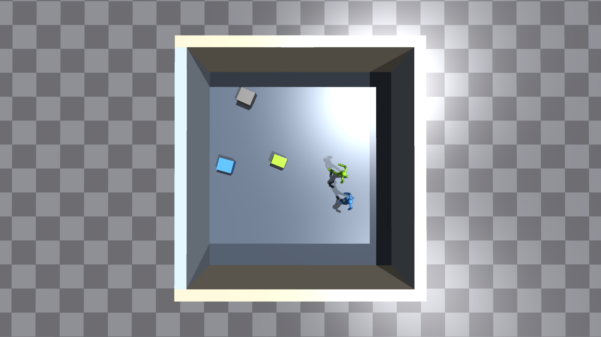
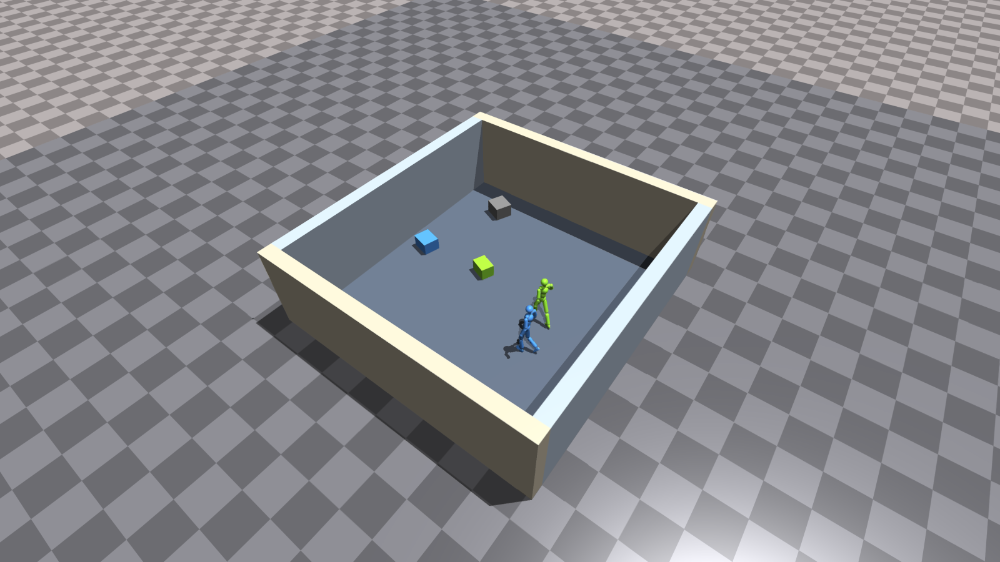
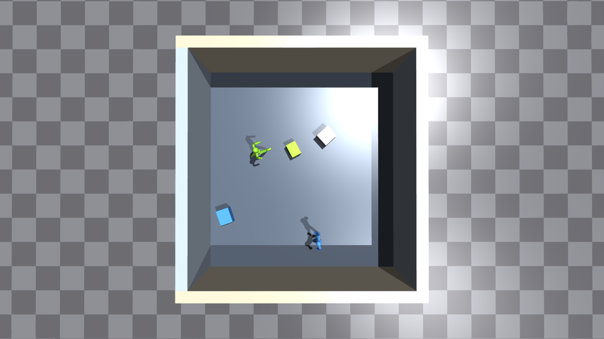
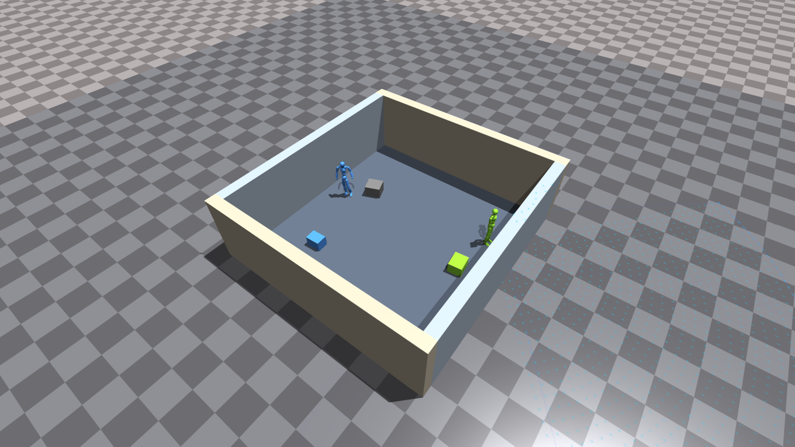

# 4면 벽 Room 구현·Isaac Gym 검증 보고서

후속 구현: [HOLDING_AT·내부 칸막이와 새 실제 화면](room_partition_report_20260930.md). 아래는 칸막이 없는 초기 room의 기록이다.

2026-09-30 · `HumanoidMARoom` · 1024개 비전센서 · 가림 없음

**4면 벽 안에 두 에이전트와 작업 객체 3개가 배치되는 방을 구현했다.** 벽을 PhysX 충돌체와 비전센서 표면에 포함하고, 기존 `collision` 보상 하나를 사람·벽의 CPA 위험도로 확장했다. 아래 사진은 실제 Isaac Gym viewer를 직접 캡처한 원본이다.

구현·물리 동작·학습/평가 실행을 검증했다. 장기 학습을 통한 벽 회피 성능은 이번 확인 범위에 포함하지 않는다.

## 1. 실제 방의 모습

### 위에서 본 초기 배치



촬영한 방의 내부 크기는 **7.5 × 8.0m**다. 연두색·파란색 에이전트 두 명과 연두색·파란색·회색 상자 세 개가 모두 네 벽 안에 있다. 상자 색은 과제 배정을 나타내며, 회색 상자도 물리 객체로 존재한다. 벽은 모서리까지 닫혀 있고, 천장은 없다.

### 사선 전경



벽은 실내 바닥 위 **2.5m** 높이, **0.4m** 두께다. 바닥은 높이 0.1m의 고정 slab이고, 벽은 외부 지면부터 실내 바닥 위 2.5m까지 이어진다. 벽은 움직이지 않는 고정 actor다.

### 다른 초기 배치



같은 방에서 reset하면 사람과 객체 위치·과제·상자 방향을 다시 샘플한다. 방의 가로·세로는 환경 생성 시 각각 6–8m, 0.5m 간격으로 정한다. 사람 root는 벽에서 최소 0.8m 안쪽, 상자는 회전 가능한 XY 외접원을 기준으로 벽에서 최소 0.2m 안쪽에 배치한다. 사람끼리·사람과 상자·상자끼리의 초기 겹침도 배제한다.

## 2. 비전센서에 벽이 들어오는 방식



이 화면은 연두색 에이전트를 벽에서 약 0.8m 떨어진 위치에 세운 센서 확인 장면이다. 하늘색 십자 중 벽 위의 점은 **벽 상단 높이를 읽은 샘플**이다. 이 에이전트의 1024개 샘플 중 11개가 벽 높이를 읽었다. 앞의 일반 배치에서는 에이전트별 50/60개, 50/46개였다.

- 머리 위치 기준 전방 100도·10m, 32고리·1024개이며 방향은 root heading을 따른다.
- 센서는 바닥·작업 상자·네 벽의 높이를 수직 조회한다. 값은 `(표면 높이 − root 높이) / 3`을 −1~1로 제한한다.
- **가림 없는 설정을 유지했다.** 따라서 벽 너머 바닥의 샘플도 표시된다. RGB 카메라처럼 벽 뒤를 숨기는 방식은 아니다.
- 벽은 graph의 엔티티 토큰에 추가하지 않았다. 기존 사람 2·객체 3·목표 2 노드와, 두 에이전트의 센서 값을 합친 **2655차원 관측**을 사용한다.
- 보상 계산에는 시뮬레이터의 실제 벽 형상과 root 속도를 사용한다. 정책에 별도의 벽 좌표·CPA·벽까지 거리 토큰을 전달하지 않는다.

## 3. 단일 CPA 충돌 보상

```text
collision_i = -0.5 × max(사람 CPA 위험도_i, 네 벽 CPA 위험도의 최댓값_i)
위험도 = 접근 정도 × max(0, 1 - d_CPA / 0.7) × 0.99^(t_CPA / dt)
dt = 1/30초
```

사람 간 CPA는 앞서 적용한 함수를 그대로 쓴다. 벽은 실제 안쪽 면을 XY 선분으로 표현한다. 일정 속도를 유지할 때의 최근접 거리·시각을 선분 내부와 양 끝점을 포함해 계산한다. 긴 벽을 중앙의 한 점으로 취급하지 않는다.

벽 전용 보상 계수를 추가하지 않고 거리 0.7m·계수 0.5·시간 할인 0.99를 공유한다. 사람과 벽 위험도를 합산하지 않으므로 `collision` 항의 범위는 여전히 **−0.5~0**이다. 기존 power·box speed·과제 보상은 유지한다.

특정 벽에서 멀어지거나 평행하게 이동하면 그 벽의 위험도는 0이다. 가까운 벽에서 멀어져도 진행 방향에 다른 벽이 있으면 그 벽의 미래 위험도가 남을 수 있다. 정지하면 CPA 접근 위험도는 0이므로, 이 항만으로 모든 신체 접촉이나 벽에 기대는 자세를 금지하지는 않는다.

**벽에 닿았다는 이유만으로 early termination하지 않는다.** 발이 벽 안쪽 경계에 닿아도 방 바닥 높이를 기준으로 판단하며, 벽 상단을 발밑 지형으로 취급하지 않는다. 넘어짐과 시간 제한 종료는 유지한다.

## 4. 확인 결과

| 검증 | 결과 |
| --- | --- |
| CPU 테스트 | room 및 기존 bridge/cliff 관련 **37개 통과** |
| CPA | 정면 접근·시간 할인, 근거리 이탈·정지·평행 이동, 벽 끝점 비껴가기, 촘촘한 시간 샘플 reference 비교 통과 |
| 초기 배치 | 64환경 × 8 reset: 에이전트 **1,024/1,024**, 객체 **1,536/1,536** 실내 배치 |
| 배치 여유 | 신체 body 중심 기준 최소 0.406m, 회전 상자 외접원 기준 최소 0.2005m |
| 센서 | 위 초기화 검사에서 모든 에이전트가 벽 높이를 관측; 최소 **21개** 샘플 |
| 실제 벽 충돌 | 네 방향에 각각 16개, 합계 **64/64** 상자의 벽 접촉 감지·중심이 실내에 남음 |
| 벽 형상 | 보상·센서의 벽 위치와 PhysX actor 위치 일치, 충돌 후 고정 위치 유지 |
| 벽 접촉 후 계속 진행 | 서 있는 사람의 벽 접촉 **64/64** 환경에서 비종료 확인 |
| 단일 보상 연결 | 사람끼리 동일 속도로 움직이는 통제 상태: 사람 위험도 0, **128/128** agent의 벽 위험도가 기존 `collision` 항에 반영 |
| 학습 | GPU 0, **2048환경**, `MAX_ITERATIONS=1`로 2 epoch 완료·checkpoint 저장 |
| 전이·수치 | actor encoder 75개·관측 RMS 6개 tensor 불변, 모델 및 scalar 173종 유한값; collision 평균 −0.1354, −0.1635 |
| 평가 | 저장한 room checkpoint로 16환경·최대 64-step 평가 완료 |
| 실제 화면 | 3개 장면·7개 PNG 저장, 위의 4개 화면을 직접 열어 배치·센서 확인 |

짧은 평가의 최종 scene 성공률은 0/16이다. 이는 실행 경로 확인이며, 벽 회피 학습이 끝났다는 결과로 해석하지 않는다. 캡처도 초기 배치·통제 센서 장면이며 학습된 회피 행동의 증거로 제시하지 않는다.

원본 증거: [physics.json](../output/approach_stage2_fan_room_cpa_check/physics/physics.json), [checkpoint_audit.json](../output/approach_stage2_fan_room_cpa_check/checkpoint_audit.json), [captures.json](../output/approach_stage2_fan_room_cpa_check/screenshots/captures.json), [학습 로그](../output/approach_stage2_fan_room_cpa_check/train.log), [평가 로그](../output/approach_stage2_fan_room_cpa_check/eval.log).

## 5. 실행·코드

실험은 `approach_stage2_fan_room`으로 분리했다. 기본 output은 `output/approach_stage2_fan_room_cpa`다. room의 sensor metadata는 version 5이며, 기존 다리·무대 checkpoint와 구분한다. 새 학습은 schema-9 Stage 1에서 전이하고, resume·평가는 room checkpoint를 사용한다.

- [환경](../tokenhsi/env/tasks/multi_agent/humanoid_ma_room.py): 네 벽 actor·실내 배치·센서·종료·보상 연결.
- [기하 계산](../tokenhsi/env/tasks/multi_agent/room_geometry.py): 선분 CPA·벽 형상·초기 배치.
- [설정](../tokenhsi/data/cfg/multi_agent/approach_stage2_fan_room.yaml), [실행 명령](config.md#stage-2-room--4면-벽).
- [물리 검사](../tokenhsi/tests/room_physics_smoke.py), [실제 viewer 캡처](../tokenhsi/tests/room_capture.py).

이번에 생성한 실행 확인용 checkpoint로 바로 볼 수 있다.

```bash
CKPT=output/approach_stage2_fan_room_cpa_check/train/ApproachStage2FanRoom_30-14-02-55/nn/ApproachStage2FanRoom.pth
TOKENHSI_GPU=0 bash tokenhsi/scripts/multi_agent/approach_stage2_fan_room_vnc.sh "$CKPT" 2 1 3 10
```
