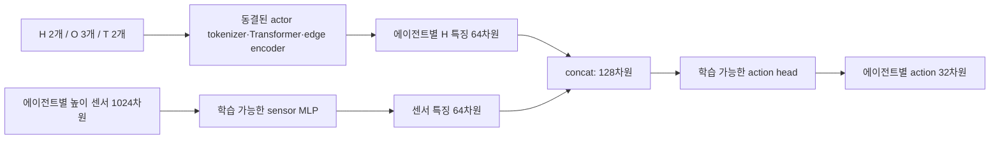
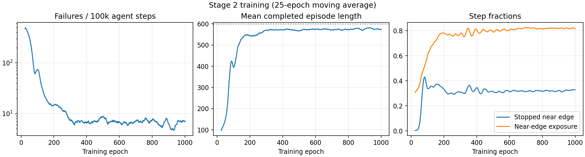
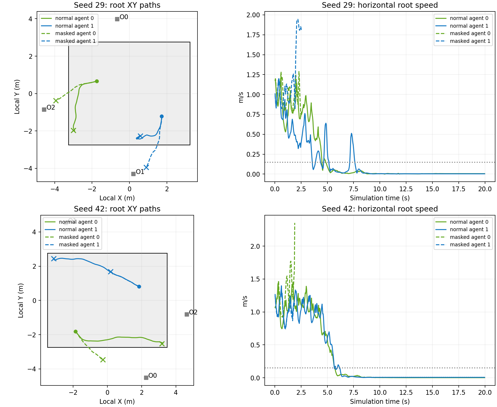
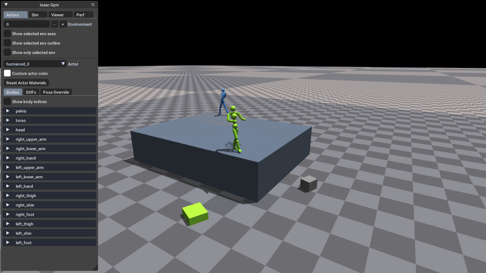
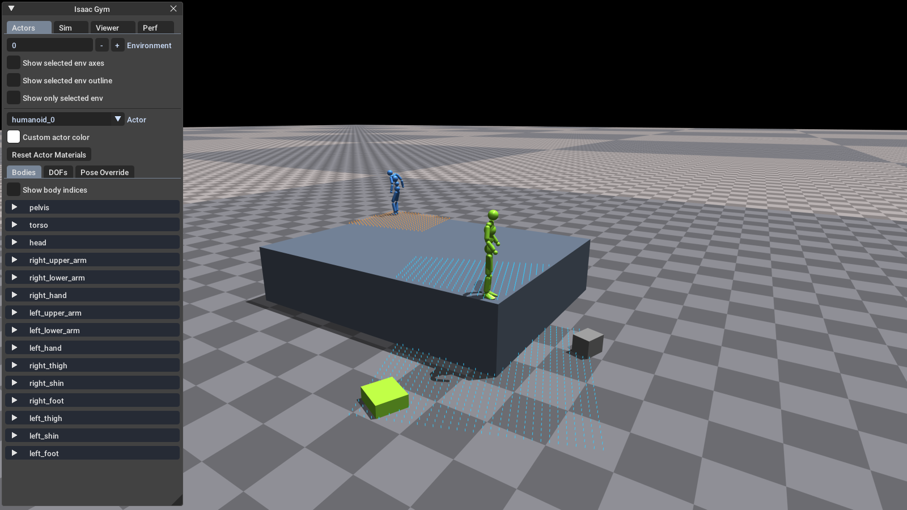
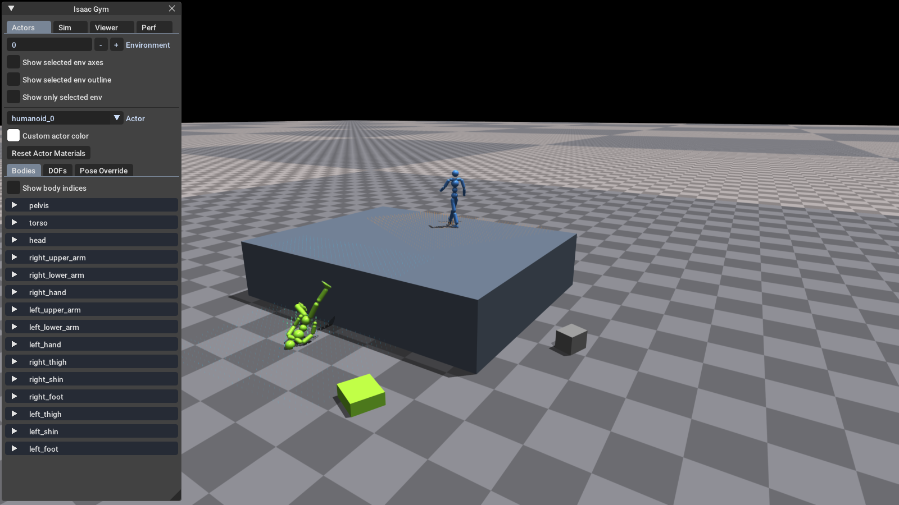

# Stage 2 높이 센서를 이용한 낙하 회피 실험 보고서

작성일: 2026-09-29 · 저장소: `TokenHSI_sensor` · 분석 checkpoint: Stage 2 **epoch 1000**

## 1. 현재 결론과 검증 범위

학습된 정책은 높이 센서가 있을 때 무대 밖으로 떨어지는 행동을 크게 줄였다. 동일한 초기 상태에서 센서 특징을 마스킹하면 낙하가 재현됐다. 이는 현재 정책이 센서 경로에 의존해 행동을 조절한다는 증거다.

다만 목표했던 **위험한 가장자리에 접근하면 적절한 위치에서 정지**하는 행동은 부분적으로 달성됐다. 직접 noVNC로 확인한 seed 42에서는 두 에이전트 모두 직선 가장자리를 따라 이동한 뒤 꼭짓점 근처에서 정지했다. Seed 29에서는 한 명이 꼭짓점 방향으로 이동한 뒤 멈췄고, 다른 한 명은 직선 가장자리에서 몸을 숙이고 멈췄다. 따라서 “항상 꼭짓점에서만 멈춘다”는 일반화는 현재 표본과 맞지 않지만, **가장자리 추종 후 꼭짓점 정지라는 불완전한 제동 전략은 재현됐다.**

이번 보고서의 직접 관찰은 1환경·2에이전트, 시드 29/42, 정상/마스킹의 **총 4회 평가**다. 대규모 성공률이나 다양한 지형에 대한 일반화 성능을 확정하는 평가가 아니다. 본학습은 계속 진행 중이므로 분석 범위를 epoch 1000까지로 고정했다.

## 2. 실험 동기

기존 Stage 1 정책은 task graph에 따라 물체에 접근하고 HOLDING, SIT, CLIMB 등의 행동을 수행한다. 그러나 목표에 접근하는 경로에 낭떠러지가 있을 때는 목표 추종과 안전한 이동을 함께 고려해야 한다.

이번 실험의 질문은 다음과 같다.

> 이미 학습한 정책의 표현을 보존하면서 높이 센서를 추가하면, 별도의 낭떠러지 회피 보상 없이도 기존 보상과 실패 종료만으로 정지·방향 전환을 학습할 수 있는가?

이를 위해 넓은 무대 위에 에이전트를 두고, 목표 객체는 무대 밖 지면에 배치했다. 객체를 향해 그대로 전진하면 떨어지도록 만들었으며, 안전한 하강 경로는 의도적으로 제공하지 않았다. 따라서 이 구성에서 평가할 핵심 행동은 객체 과제 완수보다 **위험한 접근의 중단과 무대 위 생존**이다. 목적지에 도달하는 우회 경로 탐색 능력은 이 환경으로 평가할 수 없다.

## 3. 아이디어와 설계 선택

초기에 검토한 방식은 센서를 별도 엔티티 토큰으로 추가해 `OWN_SENSOR` edge를 학습하는 방식과, H223 관찰 뒤에 센서 1024개를 붙여 하나의 tokenizer로 압축하는 방식이었다.

최종 구현에서는 checkpoint 호환성과 기존 행동 표현 보존을 위해 **센서 특징을 action head에서 합치는 방식**을 선택했다. 센서가 Transformer의 attention에 들어가는 별도 엔티티 토큰은 아니다. 새 `OWN_SENSOR` edge도 추가하지 않았다. 따라서 이번 실험의 dependency 학습은 센서에 조건화된 행동 조절을 뜻하며, 새로운 graph edge 또는 attention bias의 학습을 뜻하지 않는다.



센서 MLP는 `1024 → 256 → 128 → 64`, action head는 `128 → 1024 → 512 → 32`다. Critic도 별도 센서 MLP와 value head를 사용한다.

| 구성 요소 | Stage 2 학습 여부 |
| --- | --- |
| Actor H/O/T tokenizer, Transformer, 기존 edge encoder | 동결 |
| Actor 관찰 정규화 통계 | 동결 |
| Actor sensor MLP, action head | 학습 |
| Critic encoder, sensor MLP, value head | 학습 |
| AMP discriminator | 학습 |
| Teacher distillation loss | 사용하지 않음 |

Stage 1 출발 checkpoint는 `approach_scenario_stage1_self_sum_distill`의 epoch 14500이다. 이 checkpoint의 학습에는 teacher distillation이 적용됐지만, 이번 Stage 2에서 teacher를 다시 호출하거나 KL distillation loss를 추가하지 않는다. 출발점과 이식 결과는 [실제 전이 기록](../output/approach_stage2_cliff_sensor/ApproachStage2CliffSensor_29-15-31-44/stage2_transfer_report.json)에 남아 있다.

### Checkpoint 이식과 초기 행동 보존

첫 action-head Linear의 가중치는 기존 `[1024, 64]`를 `[1024, 128]`로 확장했다.

```python
new_weight[:, :64] = old_weight
new_weight[:, 64:] = 0
```

즉, 초기에는 `W_old × H + 0 × S + b`이므로 **같은 기존 관찰을 넣으면** 확장 전과 같은 출력을 낸다. Sensor MLP 자체는 무작위 초기화다. 첫 업데이트에서 센서 MLP로 전달되는 gradient는 0일 수 있지만, 센서 입력 열이 먼저 갱신되면 이후 업데이트부터 gradient가 전달된다. 이 동작은 CPU 테스트로 확인했다.

이는 네트워크 함수의 초기 호환성 보장이다. 새 무대의 높이차와 목표 배치가 만든 관찰 분포 변화까지 없애는 것은 아니다. Epoch 1000 checkpoint에서 action head의 센서 입력 열 norm은 약 **1.337**로, 초기 0에서 실제로 학습된 상태였다.

## 4. 환경과 관찰 구성

| 항목 | 구현 |
| --- | --- |
| 본학습 환경 수 | 2048 |
| 환경당 구성 | 에이전트 2명, 목표 객체 3개, 고정 무대 1개 |
| 무대 | 가로·세로 각각 4–8m, 0.5m 간격 샘플링; 높이 1.5m |
| 크기 갱신 | 환경 생성 시 결정하며 episode reset마다 크기를 다시 뽑지는 않음 |
| 객체 배치 | 무대 밖 지면; 회전된 footprint까지 고려한 여유 간격 0.8–1.5m |
| Task graph | HOLDING / SIT / CLIMB 각각 주변 확률 1/3; 서로 다른 객체 배정 |
| RSI | 모든 과제에서 loco만 사용 |
| AMP 참조 모션 | 기존 locomotion·sit·climb·carry 계열 분포 유지 |
| 제어 간격 / episode | 약 1/30초, 최대 약 600 step |

이 무대는 Carry 태스크에서 객체를 올려놓는 기존의 작은 random-height platform과 다르다. 두 에이전트가 함께 서 있는 큰 충돌 박스 지형이다. 무대의 중심·크기를 나타내는 별도 O 토큰은 없다.

Transformer의 엔티티는 `H_A, H_B, O_A, O_B, O_C, T_A, T_B` 총 7개다. 직렬화된 scene 관찰은 다음과 같다.

| 관찰 | 차원 |
| --- | ---: |
| 휴머노이드 2개 | 2 × 223 = 446 |
| 객체 3개 | 3 × 30 = 90 |
| 목표 2개 | 2 × 1 = 2 |
| 엔티티 pose 7개 | 7 × 7 = 49 |
| Semantic graph packet | 20 |
| 기존 scene 소계 | 607 |
| 두 에이전트의 높이 센서 | 2 × 1024 = 2048 |
| 전체 정책 관찰 | **2655** |

각 센서는 heading에 맞춰 회전하는 로컬 XY `[-2, 2]m × [-2, 2]m`의 32×32 그리드다. 현재 구현은 알려진 무대 footprint와 지면에서 높이를 계산하는 **해석적 height query**다. 실제 ray casting 센서나 움직이는 객체까지 포함하는 높이 영상은 아니다. 움직이는 객체는 기존 O 토큰으로 관측한다.

각 샘플은 `clip(지형 world Z − pelvis world Z, −3, 3) / 3`이다. 예를 들어 pelvis가 무대 상판보다 약 0.9m 위라면, 무대 위 센서값은 약 −0.3, 바깥 지면은 약 −0.8이 된다. 무대의 전체 크기를 명시적으로 전달하지 않고 주변 단차 패턴을 전달한다.

### 좌표계 검증

무대 actor는 `env_origin + [0, 0, height/2]`에 생성한다. 센서 XY는 heading-local 좌표를 yaw 회전한 뒤 root의 world XY를 더한다. 지형 높이와 신체 높이는 같은 world 기준에서 비교한다. H223의 root 높이는 무대 기준으로 보정하지만, GTA pose와 객체 상대 높이차는 실제 장면의 높이차를 유지한다.

초기 구현 검증에서 환경 원점 오프셋 누락을 발견하고 수정했다. 당시 변경 기록에는 PhysX 높이 probe 최대 오차 약 **0.0000135m**, 독립 NumPy 센서 계산 오차 **4e-8**, 16환경의 32명 지지 확인이 남아 있다. 이 과거 검증 수치는 [changelog](../changelog.md)의 기록이며, 당시 `*_check_20260929` 일부 원본 산출물은 현재 output에 존재하지 않는다. 이번 시각 평가의 원본 영상·좌표 추적은 별도로 보존했다.

## 5. 보상과 종료 조건

최종 보상은 기존 task reward와 AMP reward를 각각 0.5로 혼합한다. Task 내부의 state/progress/success 가중치는 각각 0.2이며, 자신의 과제 0.9·동료 과제 0.1 공유와 기존 power·agent collision·box speed 항목을 유지한다. 새로운 정지 보상, 가장자리 거리 보상, 명시적 생존 보상은 추가하지 않았다.

현재 `progress`는 이전 step 대비 개선량이 아니라 다음과 같은 **현재 목표 거리의 함수**다.

\[
p(d)=\frac{1}{1+\max(d-r,0)/\sigma},\qquad \sigma=1
\]

여기서 `r`은 기본 0.5m이며 CLIMB에는 객체 bbox에 따른 반경이 사용된다. 그러므로 멈춘 상태에서도 목표와의 거리에 따른 reward가 계속 발생할 수 있다. AMP 등 기존 step reward와 함께, 실패로 미래 reward를 잃지 않는 행동이 학습될 여지가 있다.

초기에는 기존 비발 부위 접촉 기반 낙상 종료를 사용했다. 사용자 시각 확인에서 에이전트가 무대에서 내려가 두 발로 정상 착지하면 실패하지 않는 문제가 확인됐다. 이후 **무대 밖 지면에 발을 포함한 어느 신체 부위든 닿으면 실패**하도록 변경했다. 같은 부위의 접촉력과 지면 상대 높이를 함께 사용하며, 무대 위 정상 발 접촉과 무대 밖 공중 상태는 허용한다. 무대 위 낙상 종료도 유지한다.

한 명이 실패하면 두 명의 환경이 함께 reset된다. 정상 동료의 value bootstrap은 유지하지만, 해당 동료의 실제 rollout도 그 지점에서 끝난다. 따라서 두 에이전트를 독립적인 생존 시험 두 개로 취급하면 안 된다. `falls`에는 무대 위 낙상과 무대 밖 바닥 접촉이 함께 집계된다.

## 6. 실행 계획과 진행 기록

1. Stage 1 weight 이식, actor 동결, `[W,0]` head 확장 및 센서 branch를 구현했다.
2. 무대 배치·센서 좌표·loco RSI·낙상 판정을 CPU와 PhysX에서 검증했다.
3. 2048환경의 짧은 학습과 checkpoint 평가로 실행 경로를 확인했다.
4. 1/4환경 watch를 추가해 실제 학습을 noVNC에서 확인했다. Viewer의 목표 표시가 센서 선을 지우던 순서 문제도 수정했다.
5. 정상 착지를 실패로 처리하도록 종료 조건을 강화하고 본학습을 진행했다.
6. 평가 전용 센서 특징 마스킹을 추가했다. CPU 센서·좌표 테스트 11개와 epoch 500의 짧은 paired 평가를 완료했다.
7. 이번에는 epoch 1000으로 1환경 시각 평가를 직접 수행하고, 두 시드에서 정상/마스킹 초기 관측 hash가 각각 일치하는지 확인했다.

본학습 PPO 설정은 learning rate `2e-5`, horizon 32, minibatch 16384, mini-epochs 6, gamma 0.99, tau 0.95다. AMP minibatch는 4096이다. Actor의 행동 분산은 고정되어 있어 entropy가 일정한 것은 정상이다. Actor loss 감소만으로 낙하 회피 성공을 판단하지 않는다.

## 7. 본학습 로그 결과

대상 실행은 `ApproachStage2CliffSensor_29-15-31-44`다. TensorBoard의 frame을 epoch와 맞춰 **1–1000 epoch**를 추출했다. 아래 실패 빈도는 세 과제의 `falls` 합계를 `agent_steps` 합계로 나눈 값이며, episode 실패 확률과는 다르다.

| 구간 | 실패 / 10만 agent-step | 평균 episode 길이 | 가장자리 체류 비율 | 가장자리 정지 비율 | 가장자리 평균 속도 |
| --- | ---: | ---: | ---: | ---: | ---: |
| 1–25 epoch | 473.69 | 97.13 | 30.88% | 0.40% | 0.998 m/s |
| 76–125 epoch | 54.40 | 441.59 | 64.11% | 34.88% | 0.272 m/s |
| 318–367 epoch | 7.03 | 571.65 | 78.48% | 33.85% | 0.324 m/s |
| 951–1000 epoch | 7.16 | 574.03 | 81.78% | 32.71% | 0.372 m/s |



그래프는 25-epoch 이동평균이다. 실패 빈도는 초반 대비 약 **98.5% 감소**했고, 평균 생존 길이는 최대 길이에 가까워졌다. 가장자리 체류 비율도 증가했으므로 중앙에만 머무르는 정책으로 설명되지는 않는다. 반면 약 300 epoch 이후에는 생존 지표가 대체로 정체되어, 계속 학습하는 것만으로 원하는 정지 위치가 개선될지는 확인되지 않았다.

AMP reward 평균은 초기 0.386에서 마지막 구간 0.488로 변했다. 학습되는 discriminator의 점수이므로 이것만으로 자세 품질 개선을 입증하지 않는다. `edge_success` reward 항은 대부분 0 또는 매우 작은 값이며, 객체 과제 완수를 학습했다고 해석할 근거는 없다. 추출한 scalar 173종은 epoch 1000까지 모두 유한값이었다.

기존 가장자리 지표는 똑바로 선 상태에서 경계까지 1m 미만을 사용한다. 정지는 속도 0.15m/s 미만, 회전은 수직축 각속도 크기 0.3rad/s 초과다. 직선 변과 꼭짓점을 구분하지 않으므로, 이 지표만으로 “낭떠러지를 보면 즉시 멈춘다”를 확인할 수 없다. 마지막 구간의 회전 비율 약 75.4%도 실제 회피 방향을 뜻하지 않는다.

## 8. 직접 시각 평가

앞서 epoch 500에서 수행한 16환경·64-step 실행 확인은 정상 센서 0/16, 마스킹 2/16 실패 종료였다. [정상 결과](../output/approach_stage2_cliff_sensor_mask_check_20260929/normal/metrics/cliff.json)와 [마스킹 결과](../output/approach_stage2_cliff_sensor_mask_check_20260929/masked/metrics/cliff.json)가 남아 있다. 이는 짧은 실행 검증이며, 아래 epoch 1000의 전체 episode 시각 평가와 합산하지 않는다.

### 평가 조건과 재현성

- 고정 checkpoint: `ApproachStage2CliffSensor_00001000.pth`.
- 1환경, 에이전트 2명, 객체 3개, random task graph, 시드 29와 42, 조건별 1 episode.
- noVNC에서 실제 Isaac Gym viewer를 실행하고 화면·root 좌표·속도·종료 flag를 함께 기록했다.
- 같은 시드의 정상/마스킹 평가에서 최초 관찰 전체의 SHA-256이 일치했다. 비교 중 checkpoint도 동일한 번호 파일로 고정했다.
- 영상은 매 3 control step에 화면을 캡처한 10 FPS 기록이다. 화면과 상태 기록 사이에는 렌더 순서에 따른 약 한 step 차이가 있을 수 있다. 종료 시점은 상태 로그 기준이다.

| 시드 | 과제 A / B | 무대 크기 | 센서 정상 | 센서 마스킹 |
| --- | --- | --- | --- | --- |
| 29 | CLIMB / CLIMB | 6.5 × 5.5m | 599 step, 실패 없이 시간 종료 | 76 step ≈ 2.53초, A 실패로 환경 종료 |
| 42 | HOLDING / SIT | 7.0 × 5.5m | 599 step, 실패 없이 시간 종료 | 57 step ≈ 1.90초, A 실패로 환경 종료 |

정상 조건의 2/2 장면은 시간 제한까지 생존했고, 마스킹 조건의 2/2 장면은 실패 종료됐다. 표본은 두 장면뿐이며 통계적 일반화 결과로 보고하지 않는다. 특히 한 명의 실패로 정상 동료도 종료되므로 마스킹에서 “4명 모두 실패했다”고 셀 수 없다.

### 가장자리 추종과 꼭짓점 정지



실선은 정상 센서, 점선은 마스킹이다. 초록은 A, 파랑은 B이며 원은 시작점, X는 종료점이다. 회색 사각형은 무대 footprint, O0–O2는 객체의 논리 인덱스다. 속도 그래프의 점선은 0.15m/s다.

Seed 42에서 A는 아래쪽 직선 가장자리를 따라 오른쪽으로 이동하고, B는 위쪽 가장자리를 따라 왼쪽으로 이동했다. 이후 서로 반대편 꼭짓점에 정지했다. 30 step 연속으로 속도 0.15m/s 미만을 유지하는 첫 구간은 A 172 step, B 185 step에서 시작했다. 마지막 60 step 평균 속도는 각각 약 0.0011, 0.0061m/s였다.

가장자리를 따라 이동 중인 120 step 화면:



599 step까지 유지된 꼭짓점 정지 화면:



정지 위치를 좌표로 확인하면 다음과 같다. 경계 거리는 root XY 기준이며 발의 접촉점이나 정확한 안전 여유 거리는 아니다.

| 정상 조건 | 종료 root XY | 가까운 X 경계까지 | 가까운 Y 경계까지 | 관찰 |
| --- | --- | ---: | ---: | --- |
| Seed 42 A | (3.178, −2.531)m | 0.322m | 0.219m | 두 경계 모두 0.5m 이내인 꼭짓점 근처 |
| Seed 42 B | (−3.145, 2.445)m | 0.355m | 0.305m | 두 경계 모두 0.5m 이내인 꼭짓점 근처 |
| Seed 29 A | (−3.002, −1.967)m | 0.248m | 0.783m | 꼭짓점 방향 이동 후 정지; 위 0.5m 기준으로는 꼭짓점 구역 밖 |
| Seed 29 B | (0.589, −2.260)m | 2.661m | 0.490m | 직선 가장자리에서 몸을 숙인 채 정지 |

Seed 29의 직선 가장자리 정지는 “꼭짓점에서만 멈춘다”는 설명의 반례다. 동시에 몸을 숙여 멈춘 모습은 생존뿐 아니라 정지 자세의 품질도 별도로 살펴야 함을 보여준다. [해당 원본 화면](../output/cliff_visual_report_20260929/normal_seed29/frame_0599.png).

### 센서 마스킹의 시각적 결과

`SENSOR_MASK=1`은 raw 센서 1024개를 0으로 바꾸는 방식이 아니다. Sensor MLP를 통과한 **64차원 특징 전체를 head 직전에 0으로 만든다.** Encoder bias까지 포함한 센서 branch의 출력을 제거하며, H 특징과 checkpoint 가중치는 유지한다. Critic 특징도 같은 방식으로 마스킹한다. 화면의 센서 선과 실제 지형 진단값은 계속 계산한다.

Seed 42에서는 A가 앞쪽 가장자리에서 감속·접선 방향 이동을 충분히 하지 못하고 밖으로 떨어졌다. 57 step에서 실패했으며, 그 시점 B는 무대 위에 있었다.



원본 영상: [시드 29 정상](../output/cliff_visual_report_20260929/normal_seed29/viewer.mp4) · [시드 29 마스킹](../output/cliff_visual_report_20260929/masked_seed29/viewer.mp4) · [시드 42 정상](../output/cliff_visual_report_20260929/normal_seed42/viewer.mp4) · [시드 42 마스킹](../output/cliff_visual_report_20260929/masked_seed42/viewer.mp4).

## 9. 결과 해석과 남은 문제

**센서 경로의 행동 기여는 확인됐다.** 같은 초기 관찰과 checkpoint에서 특징 마스킹만 바꾸었을 때 이동 경로와 생존 결과가 달라졌다. 기존 CPU 테스트에서도 마스킹 시 센서값을 바꿔도 actor·critic 출력이 같고, 정상 조건에서는 actor 출력이 달라지는 것을 확인했다. 다만 64차원 영벡터는 학습 분포 밖의 특징일 수 있다. 결과는 센서 branch에 대한 의존성을 보여주며, 지형의 모든 공간 관계를 올바르게 해석한다는 증명은 아니다.

**낙하 회피와 정지 위치의 적절성은 별도 문제다.** 현재 보상에는 위험을 처음 감지한 지점에서 멈추라는 조건이 없다. 직선 변을 따라 이동해도 떨어지지 않는 한 기존 접근 보상을 받을 수 있다. 따라서 낙하 횟수 감소만으로 원하는 제동 전략이 완성됐다고 볼 수 없다.

꼭짓점에서는 두 방향의 센서에 낮은 지면이 나타나고 이동 가능한 무대 영역이 줄어든다. 정책이 이 패턴에서 더 강하게 정지하도록 학습했을 가능성이 있다. 그러나 이는 **가설**이다. 직선 변·꼭짓점에서 같은 자세·속도·목표 방향을 맞춘 비교를 하지 않았으므로 원인을 확정하지 않는다.

또한 “꼭짓점이 목표에 가장 가까워서 멈춘다”고 단정할 수 없다. Seed 42의 A 목표 X는 약 2.271m인데 정지 X는 3.178m로, 목표의 직선 투영 위치를 지나쳤다. B도 목표 X 약 −2.418m보다 더 왼쪽인 −3.145m에서 멈췄다. 목표 접근 압력, 학습된 이동 관성, 센서 패턴에 대한 반응이 함께 만든 정지 위치로 해석하는 편이 현재 증거에 맞다.

학습 로그에서 센서가 단차를 보는 step 비율은 매우 높다. 센서 범위가 4×4m이고 시작 위치도 무대 가장자리에 가까울 수 있기 때문이다. 따라서 “단차를 처음 보는 순간”과 “현재 속도로 계속 가면 위험한 순간”을 구분해야 한다. 현재는 제동 거리·접근 속도·이동 방향에 대한 별도 목표가 없다.

## 10. 다음 검증 계획

아래는 후속 제안이며 이번 작업에서 정책이나 보상을 변경하지 않았다.

1. **직선 변과 꼭짓점 구분:** 두 경계까지의 거리를 함께 기록하고, 직선 변에서의 접근 속도·제동 시작 거리·지속 정지까지 이동한 거리를 평가한다. 전체 `falls`와 함께 보고한다.
2. **동일 초기 상태의 다중 시드 평가:** 정상/마스킹을 더 많은 시드·무대 크기·목표 방향에서 비교한다. 두 명의 공유 reset에 따른 scene 단위 실패율과 agent별 실제 실패를 구분한다.
3. **마스킹의 분포 변화 확인:** 센서 특징 평균값 대체, 공간 배치 섞기 등의 추가 조건으로 영벡터 자체의 영향과 공간적인 단차 정보의 영향을 구분한다.
4. **추가 보상 없이 개선할 경우:** 직선 가장자리에서의 다양한 접근 방향·속도를 충분히 경험하도록 초기 상태 분포를 검토한다. 꼭짓점이 없는 지형에서 정지 능력이 유지되는지도 별도 실험으로 확인한다.
5. **정지 위치를 명시적으로 개선할 경우:** 원하는 안전 거리와 제동 기준을 먼저 정의한 뒤 보상·종료 조건 변경 여부를 결정한다. 이는 현재의 “추가 보상 없음” 실험과 별도 조건으로 관리해야 한다.

## 11. 재현 명령과 근거 파일

저장소 루트에서 다음과 같이 같은 고정 checkpoint와 시드를 사용한다. `SENSOR_MASK=0`으로 정상 센서, `1`로 마스킹 평가를 실행한다. Viewer 환경 수는 **1**이다.

```bash
CKPT='output/approach_stage2_cliff_sensor/ApproachStage2CliffSensor_29-15-31-44/nn/ApproachStage2CliffSensor_00001000.pth'

TOKENHSI_GPU=0 SENSOR_MASK=0 SENSOR_VIS=1 SEED=42 \
OUTPUT_PATH=output/cliff_visual_normal_replay \
bash tokenhsi/scripts/multi_agent/run-gui.sh \
  bash tokenhsi/scripts/multi_agent/approach_stage2_cliff_sensor_test.sh "$CKPT" 2 1 3 1

TOKENHSI_GPU=0 SENSOR_MASK=1 SENSOR_VIS=1 SEED=42 \
OUTPUT_PATH=output/cliff_visual_masked_replay \
bash tokenhsi/scripts/multi_agent/run-gui.sh \
  bash tokenhsi/scripts/multi_agent/approach_stage2_cliff_sensor_test.sh "$CKPT" 2 1 3 1
```

현재 서버의 noVNC 서비스는 5802 포트다. 이번 평가에서는 기존 학습 프로세스와 GUI 서비스를 유지했고, 확인용 프로세스는 모두 종료했다. 화면 기록용 계측은 별도 output의 실행 스크립트에서 수행했으며 생산 정책 코드는 수정하지 않았다.

| 근거 | 파일 |
| --- | --- |
| 학습 구간 통계 | [training_summary.json](../output/cliff_visual_report_20260929/training_summary.json) |
| 시각 평가 수치·초기 상태 일치 | [visual_summary.json](../output/cliff_visual_report_20260929/visual_summary.json) |
| Checkpoint hash·epoch·영상 검증 | [artifact_audit.json](../output/cliff_visual_report_20260929/artifact_audit.json) |
| 화면·trajectory 기록 도구 | [capture_eval.py](../output/cliff_visual_report_20260929/capture_eval.py) |
| 통계·그림 생성 도구 | [analyze.py](../output/cliff_visual_report_20260929/analyze.py) |
| 환경 설정 | [approach_stage2_cliff_sensor.yaml](../tokenhsi/data/cfg/multi_agent/approach_stage2_cliff_sensor.yaml) |
| PPO/AMP 설정 | [amp_ma_cliff_sensor.yaml](../tokenhsi/data/cfg/train/rlg/amp_ma_cliff_sensor.yaml) |
| 무대·센서·종료 구현 | [humanoid_ma_cliff.py](../tokenhsi/env/tasks/multi_agent/humanoid_ma_cliff.py), [cliff_geometry.py](../tokenhsi/env/tasks/multi_agent/cliff_geometry.py) |
| 정책의 late fusion·마스킹 | [amp_network_builder_ma.py](../tokenhsi/learning/multi_agent/amp_network_builder_ma.py) |

영상과 세부 JSON은 `output/`에 있으며 Git으로 추적되지 않을 수 있다. 보고서의 주요 화면과 그래프는 `markdowns/assets/cliff_sensor_20260929/`에 함께 보존했다.
